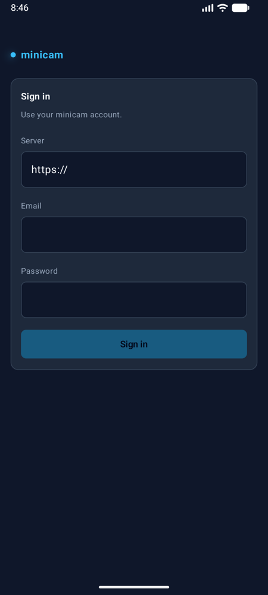
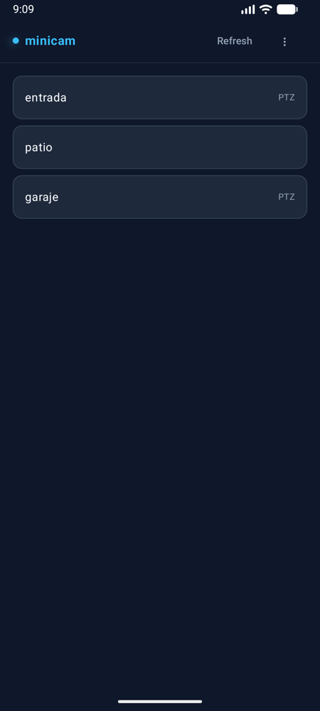
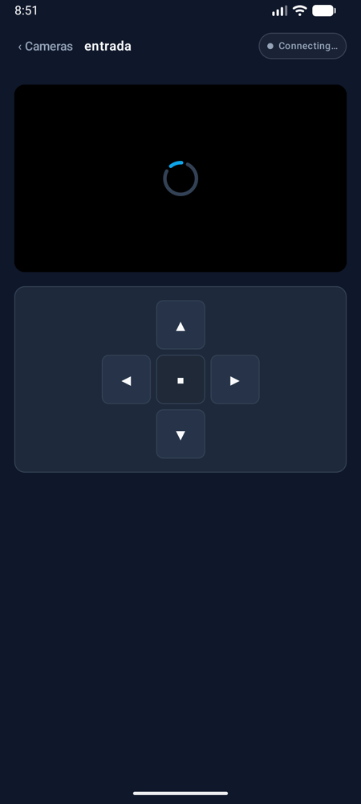
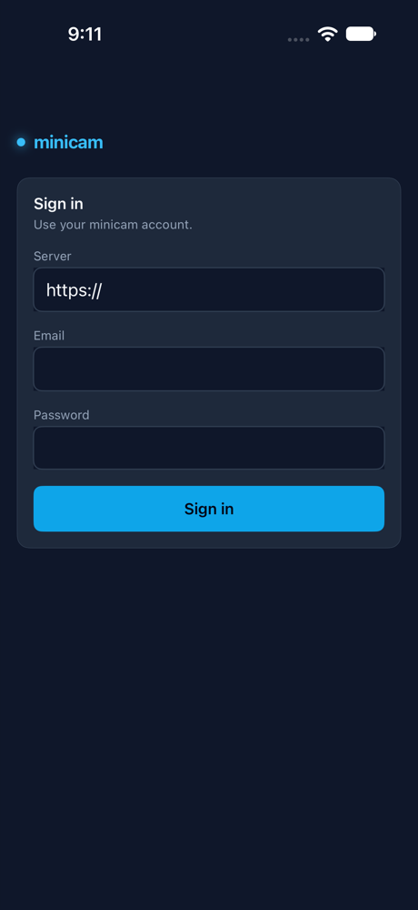
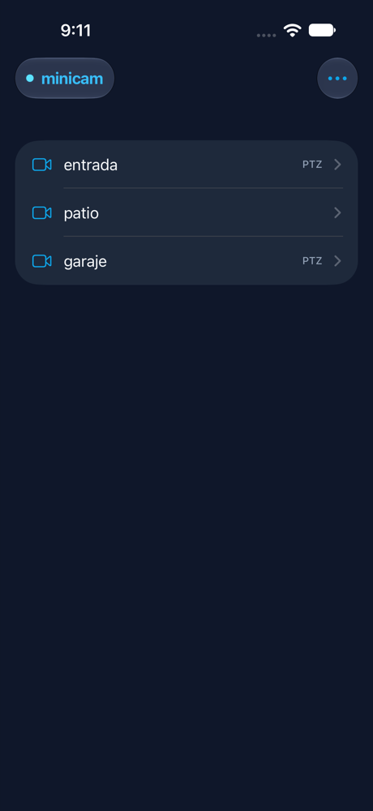
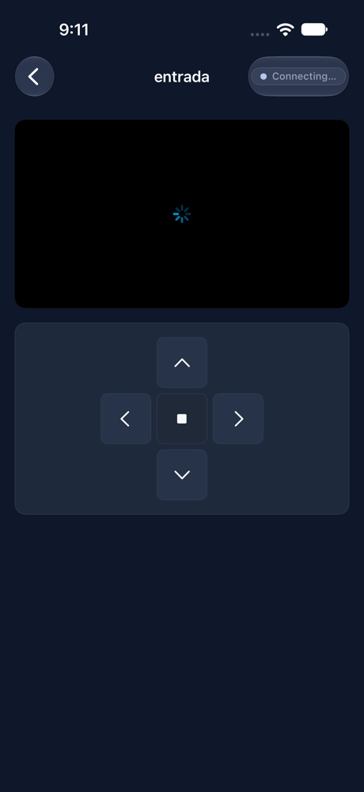

# minicam-mobile

Native Android and iOS viewers for a self-hosted [minicam](https://github.com/black-redoc/minicam)
server: log in, watch the cameras you're allowed to see, drive PTZ. Works on the LAN and through
Cloudflare Tunnel + Access. Same dark slate / sky look as the desktop dashboard.

## Screenshots
Taken from the Android emulator and the iOS simulator against a local minicam with placeholder
cameras (no real RTSP feed, so the video stays on "Connecting…").

| | Sign in | Cameras | Live view + PTZ |
|---|---|---|---|
| **Android** |  |  |  |
| **iOS** |  |  |  |

iOS screenshots are regenerated by the `ScreenshotTests` UI test (see
[docs/VALIDATION.md](docs/VALIDATION.md#readme-screenshots)).

## Install
Every merge to `master` publishes a [release](https://github.com/black-redoc/minicam-mobile/releases/latest)
with `minicam-android.apk` (Android 8.0+), an unsigned `minicam-ios-unsigned.ipa` (re-sign with
AltStore, Sideloadly or Xcode) and a simulator build. See [ADR 0003](docs/adr/0003-ci-cd-github-actions.md).

## Layout
```
android/            Kotlin + Jetpack Compose app
ios/MinicamKit/     Swift package: API, auth, stream (tested with `swift test`)
ios/MinicamApp/     SwiftUI app (Xcode project generated with XcodeGen)
docs/               Plan, architecture, security, specs and ADRs — start at docs/PLAN.md
```

## Quick start
See [docs/DEVELOPMENT.md](docs/DEVELOPMENT.md) for toolchains and [docs/VALIDATION.md](docs/VALIDATION.md)
for the test/lint/build commands.

```bash
cd ios/MinicamKit && swift test      # core iOS logic, no Xcode needed
cd android && ./gradlew testDebugUnitTest
```

## Requirements on the server
The apps need two endpoints that minicam doesn't have yet:
`GET /api/me/cameras` and `GET /api/mobile/access-handoff`
([spec 002](docs/specs/002-backend-mobile-endpoints.md)).
